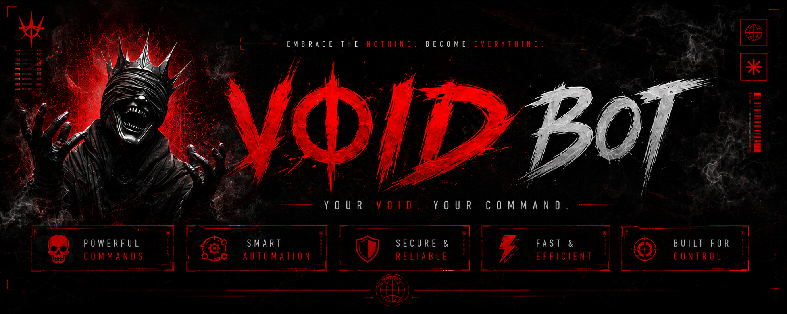

<div align="center">



# THE VØID

**`EMBRACE THE NOTHING. BECOME EVERYTHING.`**

A WhatsApp bot built on Baileys 7 — rebuilt from nothing, owned by nobody but you.

<br>


</div>

---

## ▚ WHAT THIS IS

A personal WhatsApp automation bot. It links to your account as a companion
device and answers commands with a `.` prefix — media conversion, downloads,
group moderation, AI, film lookups.

It is a **ground-up rebuild**. The v1 it replaces phoned home to its author's
servers for a live list of numbers granted remote `eval()` on your machine,
shipped eight hardcoded database credentials shared across every install, and
had an update command that deleted its own source. None of that survived.

> **Void law:** nothing in this bot talks to anyone but you. No remote operator,
> no shared database, no telemetry, no kill switch. Your keys, your database,
> your session, your machine.

---

## ▚ REQUIREMENTS

| | |
|---|---|
| **Node.js** | 22.5 or newer — the built-in `node:sqlite` module is required |
| **RAM** | 512 MB minimum, 1 GB comfortable (ffmpeg and sharp are hungry) |
| **A phone** | With WhatsApp, to link the device |
| **MongoDB** | Optional — falls back to a local SQLite file |

`ffmpeg` and `yt-dlp` are **not** system requirements. Both binaries install
automatically with the npm dependencies.

---

## ▚ SUMMONING

```bash
npm install
```

```bash
cp .env.example .env
```

Open `.env` and set one required value — your own number, full international
format, digits only, no `+` and no leading zero:

```bash
OWNER_NUMBER=94771234567
```

```bash
npm start
```

Scan the QR from the terminal, or open `http://localhost:8000` to scan it in a
browser. Then message yourself `.menu`.

Prefer a code to a QR? Set `PAIR_NUMBER` to your number and the terminal prints
an 8-digit pairing code for **Linked devices → Link with phone number**.

### Scripts

| Command | Does |
|---|---|
| `npm start` | Run the bot |
| `npm run dev` | Run with auto-restart on file changes |
| `npm run reset` | Delete the session and pair again |
| `npm run export-session` | Print the login as `SESSION_ID` for deployment |

---

## ▚ THE ARSENAL

**73 commands.** `.menu` lists them live; `.menu <command>` explains one.

<details open>
<summary><b>⌁ DOWNLOAD</b> — one yt-dlp engine, ~1800 sites</summary>

`.song` `.video` `.dl` `.dlaudio` `.tiktok` `.fb` `.insta` `.twitter`
`.mediafire` `.dlupdate`

`.song` and `.video` accept a **search term or a link**. `.video lofi 480`
caps quality. `.dlupdate` refreshes the yt-dlp engine when a site changes and
downloads start failing.

</details>

<details>
<summary><b>⌁ GROUP</b> — moderation and control</summary>

`.kick` `.add` `.promote` `.demote` `.tagall` `.hidetag` `.ginfo` `.link`
`.revoke` `.lock` `.unlock` `.mute` `.unmute` `.leave` `.setwelcome`
`.antilink` `.antilinkaction` `.antibad` `.welcome` `.goodbye` `.nsfw`

Anti-link escalates `delete → warn → kick` against a per-group warning limit.
Admins and sudo users are always exempt.

</details>

<details>
<summary><b>⌁ TOOLS</b> — media conversion</summary>

`.sticker` `.toimage` `.tovoice` `.tomp3` `.vv`

`.sticker` handles stills, video and GIFs, brands the pack with your bot name,
and falls back to an unbranded sticker rather than failing if metadata cannot
be written.

</details>

<details>
<summary><b>⌁ AUDIO</b> — ffmpeg filter chains</summary>

`.bass` `.deep` `.fast` `.slow` `.nightcore` `.robot` `.reverse` `.chipmunk`

</details>

<details>
<summary><b>⌁ AI</b> — Google Gemini</summary>

`.ai` `.aiclear` `.translate`

`.ai` reads images — reply to a photo and ask about it. Conversation memory is
per-user, in RAM only, and dies with the process. Nothing is written to disk.

</details>

<details>
<summary><b>⌁ MOVIE</b> — metadata and subtitles</summary>

`.movie` `.tv` `.trending` `.cast` `.imdb` `.sub` `.subget`

Subtitles come from the OpenSubtitles API. `.sub si Interstellar` searches
Sinhala; `SUBTITLE_LANGS` sets your default.

</details>

<details>
<summary><b>⌁ OWNER</b> — runtime control</summary>

`.settings` `.set` `.mode` `.prefix` `.ban` `.unban` `.banlist` `.block`
`.unblock` `.restart`

`.set <key> <value>` changes behaviour live — no restart, no redeploy.
`.set antiDelete on`, `.set autoRead on`, and so on.

</details>

<details>
<summary><b>⌁ GENERAL &amp; UTILITY</b></summary>

`.menu` `.ping` `.alive` `.jid` `.owner` `.calc` `.define` `.weather` `.yts`

</details>

---

## ▚ ACCESS MODES

The bot ignores everyone except its owner by default. Change with `.mode`:

| Mode | Who can use it |
|---|---|
| `private` | Owner and sudo only *(default)* |
| `public` | Anyone, anywhere |
| `group` | Anyone, but only inside groups |
| `inbox` | Anyone, but only in direct messages |

---

## ▚ CONFIGURATION

Everything lives in `.env`. Nothing is hardcoded.

| Key | Default | Purpose |
|---|---|---|
| `OWNER_NUMBER` | — | **Required.** Digits only |
| `PREFIX` | `.` | Command character |
| `MODE` | `private` | Who may issue commands |
| `MONGO_URI` | — | Optional; SQLite is used when absent |
| `MAX_UPLOAD_MB` | `90` | Send-size ceiling |
| `MAX_DURATION_MIN` | `20` | Refuse longer media before downloading |
| `DOWNLOAD_CONCURRENCY` | `2` | Parallel yt-dlp/ffmpeg jobs |
| `RATE_LIMIT_PER_MIN` | `20` | Per-user command ceiling |

**Optional keys.** A missing key disables exactly one command and nothing else —
the bot never refuses to start over an integration.

| Key | Unlocks | Free from |
|---|---|---|
| `GEMINI_API_KEY` | `.ai` `.translate` | [aistudio.google.com](https://aistudio.google.com/apikey) |
| `TMDB_API_KEY` | `.movie` `.tv` `.trending` `.cast` | [themoviedb.org](https://www.themoviedb.org/settings/api) |
| `OMDB_API_KEY` | `.imdb` | [omdbapi.com](https://www.omdbapi.com/apikey.aspx) |
| `OPENSUBTITLES_API_KEY` | `.sub` `.subget` | [opensubtitles.com](https://www.opensubtitles.com/consumers) |
| `OPENWEATHER_API_KEY` | `.weather` | [openweathermap.org](https://openweathermap.org/api) |

---

## ▚ ANATOMY

```
src/
├─ index.js          boot, shutdown, keepalive
├─ config.js         env parsing + validation
├─ core/
│  ├─ socket.js      Baileys connection, reconnect, pairing
│  ├─ handler.js     permissions, rate limits, dispatch
│  ├─ serialize.js   raw message → flat object
│  ├─ registry.js    command registration and loading
│  ├─ group.js       metadata cache, admin checks
│  ├─ events.js      welcome, anti-delete, calls
│  └─ msgcache.js    bounded recent-message store
├─ commands/         one file per category — drop one in, it loads
├─ features/         passive hooks (anti-link, word filter)
├─ store/            mongo + sqlite, one interface
├─ lib/              logger, http, media, jid, ytdlp, format
└─ web/server.js     QR page + health endpoints
```

**Adding a command** — create a file in `src/commands/`, and it is picked up on
next start:

```js
import { command } from '../core/registry.js';

command(
  { name: 'echo', category: 'general', desc: 'Repeat something back' },
  async ({ m, text }) => m.reply(text || 'Say something.'),
);
```

Gates are declared, not coded: `ownerOnly`, `adminOnly`, `botAdmin`, `groupOnly`,
`privateOnly`, `nsfw`, `requires: ['SOME_KEY']`, `cooldown`. The handler enforces
them before your function ever runs.

---

## ▚ DEPLOYMENT

See **[DEPLOY.md](DEPLOY.md)** — Railway (recommended) and Koyeb runbooks.

Ships with a [`Dockerfile`](Dockerfile), [`railway.json`](railway.json) and an
entrypoint that fixes volume ownership before dropping privileges.

Three rules that decide whether a deploy works:

- **Health checks point at `/live`**, never `/health`. `/health` returns 503
  until WhatsApp links, so a restarting check aimed at it kills every deploy
  before it can finish connecting.
- **Exactly one replica.** Two instances sharing a session fight over the
  connection and kick each other off forever.
- **Persist `session/`** — mount a volume at `/app/session`, or seed it with
  `SESSION_ID` on hosts without disks.

---

## ▚ WARDS

What this bot deliberately refuses to do:

- **No remote control.** No developer list fetched at runtime, no `eval` backdoor, no kill switch.
- **No shared credentials.** Your database, your API keys, in your `.env`.
- **No third-party proxies.** yt-dlp runs locally; nobody sees what you download.
- **No self-destruction.** `npm run reset` touches the session folder and nothing else.
- **No credential logging.** The session is printed only when you explicitly ask.

Keep it that way: `.env` and `session/` are gitignored. Verify before your first
push — this must print nothing:

```bash
git status --porcelain --ignored=no | findstr /I ".env session data"
```

---

## ▚ WHEN IT BREAKS

| Symptom | Cause | Fix |
|---|---|---|
| `session logged out` | Device revoked | `npm run reset`, pair again |
| `store sqlite` when Mongo is set | Atlas refused the connection | Allow your IP in Atlas Network Access |
| `querySrv ECONNREFUSED` | Network blocks SRV DNS | Use the non-SRV `MONGO_URI` form |
| `.song` fails suddenly | Site changed its player | `.dlupdate` |
| Killed during a download | Out of memory | Lower `MAX_DURATION_MIN`, set `DOWNLOAD_CONCURRENCY=1` |
| Commands ignored | `MODE=private` | `.mode public`, or message from the owner number |

---

<div align="center">

**Built on [Baileys](https://github.com/WhiskeySockets/Baileys).**
Running an automation on a personal WhatsApp account carries a ban risk, and
downloading from third-party sites may breach their terms. You operate it; you
own that.

<br>

`▚▚▚  EMBRACE THE NOTHING. BECOME EVERYTHING.  ▚▚▚`

</div>
